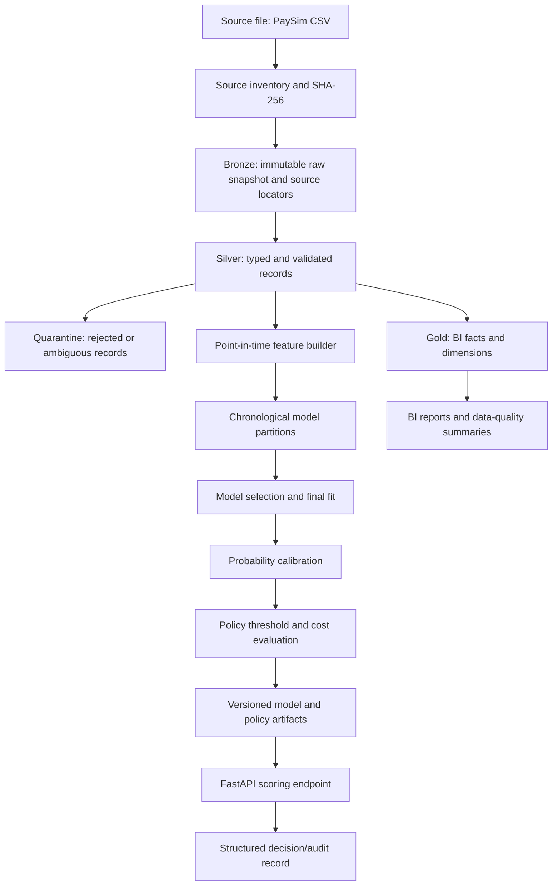

# Financial Fraud & Risk Intelligence Platform
## Master Engineering Plan

> **Document ID:** DOC-ARCH-000  
> **Version:** 4.2.0  
> **Document status:** Implementation baseline; Phase 0 repository inspection is still pending  
> **Project status:** Not verified end-to-end; implementation evidence must be recorded phase by phase  
> **Last updated:** 2026-10-19  
> **Author:** Ebram Rafat  
> **Repository:** <https://github.com/ebramrafat653-wq/fraud-risk-platform>

### Revision record — v4.2.0

This revision closes the remaining mandatory-before-Phase-0 gaps found in engineering review of v4.1.2:

- §7.5 (new) adds a schema-version compatibility policy: `MAJOR.MINOR` versioning, what each kind of change requires, and a fail-closed rule for any downstream reader that encounters a `schema_version` it does not declare support for.
- §7.6 (new) adds an explicit, deterministic downstream business-key deduplication rule for Gold and the ML feature pipeline, kept distinct from Silver's source-locator uniqueness and from the "flagged, not resolved" business-key-collision rule already in §7.2.
- §8.7 (new) defines where the API's decision/audit record lives and how it is written: an append-only log, explicitly separate from the Bronze/Silver/Gold/model pointer protocol in §8.2–§8.5, because an append is a different access pattern from a versioned snapshot.
- §4.2 adds one line clarifying that MLflow is used for local experiment-tracking ergonomics; the run manifest and dataset/model hashes (§8.3) remain the authoritative source for reproducibility.
- §4.4 (new) states explicitly that Colab + Drive (ADR-0012) is the primary environment through Phase 6, that Docker (Phase 7) and CI never touch a live Drive mount, and which test layers each environment can and cannot run.
- §4.3 adds an explicit note that a Colab session can disconnect without warning and that any step expected to run long must checkpoint to Drive rather than hold required state only in session memory or on session disk.
- §8.4 step 4 strengthens the Drive read-back requirement: verification must use a fresh file open/stat, not a cached handle or directory listing, because the Drive FUSE layer may briefly serve a stale cached view after a write.
- §14.1 states explicitly that CI and Environment tests are separate gates (see §4.4); a phase gate that needs Drive-based evidence is not satisfied by a CI badge alone.
- §15 adds a rough, explicitly non-binding effort estimate per phase, for planning only.
- ADR-0013 (new) records the schema-versioning and downstream-deduplication decision.
- §5.1/§9.1 balance-field wording was reviewed for internal consistency and required no change.

### Revision record — v4.1.2

This revision incorporates the Colab/Google Drive execution decision and closes specific contract gaps found in review:

- ADR-0012 documents Colab's ephemeral runtime and Drive-backed persistence, including the limits of FUSE rename, locking, and I/O guarantees.
- Local scratch/staging and Drive-persistent data/model/evidence roots are separated; `colab_setup.py` is a required bootstrap deliverable.
- Publication on Drive is described as best-effort logical publication, with immutable run targets, read-back verification, fail-closed pointer validation, and an explicit availability limitation during pointer updates.
- A Drive marker is treated as an operational guard, not a distributed lock; the core contract remains single-writer.
- Successfully published runs reconcile `accepted + quarantined = parsed_source_count`; a run-level `REJECT` is never activated by a pointer.
- Feature, imbalance, policy-cost, API response, path, benchmark, and release-evidence contracts are clarified where previous commitments were incomplete.
- Published PaySim prevalence is identified only as a reference claim (~0.1291% for the commonly distributed snapshot); the local Phase 1 audit remains authoritative for the downloaded file.

---

## 1. Executive summary

The Financial Fraud & Risk Intelligence Platform is a portfolio-grade engineering project that demonstrates how financial transaction data can move from raw files to validated analytical datasets, leakage-aware fraud models, economically explicit risk decisions, and a small API for scoring and auditability.

The project is intentionally built as a series of independently testable slices. The first deliverable is a reliable local pipeline using **one source dataset (PaySim), Python, DuckDB, and Parquet**. Additional datasets and distributed technologies are added only after the core path works and a measurable requirement justifies the added complexity.

The system is a **synthetic-data learning and demonstration platform**. It is not a bank production system, does not connect to payment rails, and must not claim real-world fraud-prevention effectiveness. Metrics from synthetic data describe performance on that dataset and its simulation assumptions—not expected performance in a live institution.

### 1.1 Primary outcomes

By the end of the core project, a reviewer should be able to:

1. Reproduce the data pipeline from a documented source file to versioned, validated Parquet outputs.
2. Trace every processed record to a source file, source-row locator, processing run, and schema version.
3. Explain every data-quality decision, including quarantine, duplicate handling, timestamp semantics, and label provenance.
4. Build a point-in-time feature dataset without future-information leakage.
5. Compare a simple baseline with a stronger tabular model using chronological splits, probability calibration, and separately selected decision thresholds.
6. Report model quality, operational-policy behavior, and estimated business costs as distinct groups of metrics.
7. Serve a risk score through a minimal API with input validation, explicit artifact readiness, versioned outputs, and fail-closed behavior.
8. Reproduce the result from repository documentation and automated tests.

### 1.2 Definition of success

Success is based on demonstrated behavior, not the number of technologies listed in the repository. A feature is complete only when its contract, implementation, automated tests, and evidence are all present. A design statement by itself is not implementation evidence.

---

## 2. Scope and non-goals

### 2.1 In scope

- Data-source inventory and provenance.
- Local batch ingestion and repeatable processing.
- Bronze, Silver, and Gold data layers.
- Data contracts, quality checks, quarantine, and lineage.
- Fraud-label semantics and label-availability documentation.
- Point-in-time feature engineering.
- Chronological train/validation/calibration/threshold/test partitions.
- Baseline and tree-based supervised classification.
- Probability calibration and policy-threshold selection.
- Cost-aware decision simulation for `APPROVE`, `CHALLENGE`, and `BLOCK`.
- BI-ready dimensional data and a clearly defined metric catalogue.
- Minimal FastAPI scoring interface, artifact readiness, structured logs, and tests.
- Docker packaging and continuous integration after local execution is stable.
- Optional extensions for fairness, AML, streaming, graph data, Spark, and operational monitoring.

### 2.2 Explicitly out of scope for the core release

- Real bank, card-network, or payment-provider integration.
- Real customer data, personally identifiable information, account credentials, or production secrets.
- Real-time distributed processing before a local baseline is measured.
- A claim that fraud on synthetic data is equivalent to fraud in a real institution.
- A claim of regulatory compliance, production-grade security certification, or production service-level guarantees.
- Automatic model retraining in production.
- Mandatory deployment on paid cloud services.
- Mandatory use of Kafka, Spark, Redis, Airflow, Iceberg, Kubernetes, or a feature store in the first release.

### 2.3 Guardrail against overengineering

A technology is not included merely because it is common in data-engineering job descriptions. Add it only when at least one of the following is true:

- A concrete requirement cannot be met adequately by the current solution.
- A reproducible benchmark shows a meaningful limitation.
- An extension has a defined learning or evaluation objective.
- The technology replaces a clearly identified bottleneck rather than introducing an unmeasured one.

---

## 3. Engineering principles

1. **Evidence before implementation.** Inspect the actual file, schema, value distributions, and license before relying on assumptions about a dataset.
2. **Small vertical slices.** Make one source-to-output path work before adding more sources or infrastructure.
3. **Semantic integrity.** Never make synthetic step numbers look like real-world timestamps; never call estimated costs observed business losses.
4. **Leakage-safe evaluation.** All learned transformations and predictors must respect the information available at the decision time.
5. **One definition per metric.** Business, model, data-quality, and runtime metrics must have documented formulas and scopes.
6. **Reproducible lineage.** Inputs, code version, configuration, random seed, schemas, and output hashes must be traceable.
7. **Fail closed on scoring readiness.** An unavailable or invalid model must not silently produce an approval decision.
8. **Idempotent processing.** Re-running the same source under the same configuration should not create unexplained duplicate business outputs.
9. **Measured complexity.** Local tools remain the default until evidence justifies distributed systems.
10. **Honest claims.** The README must separate implemented, tested, planned, and illustrative behavior.

---

## 4. System overview

### 4.1 Core data flow



The diagram describes the intended architecture. It must not be interpreted as proof that every component has been implemented.

### 4.2 Core technology choices

| Concern | Core choice | Reason | Upgrade trigger |
|---|---|---|---|
| Language and environment | Python with `uv` | Reproducible local development | Change only for a specific compatibility requirement |
| Analytical storage | Parquet | Columnar, portable, compressed storage | Evaluate table format only when update/concurrency needs appear |
| Local analytical engine | DuckDB | SQL-based, local analytics without a server | Benchmark a distributed engine only after a measured bottleneck |
| Data schemas | Pydantic and explicit column contracts | Human-readable validation boundaries | Use a broader schema registry only for multi-service needs |
| Testing | pytest | Unit, contract, integration, and regression tests | No change required for core scope |
| ML | scikit-learn baseline; one tree-boosting library if justified | Establish a baseline before model complexity | Add XGBoost or LightGBM after baseline/evaluation is stable; do not require both by default |
| Experiment tracking | MLflow local tracking | Record parameters, metrics, and artifact lineage | A remote tracking server is optional |
| API | FastAPI | Typed request/response contract and simple serving | A gateway is out of scope until deployment needs require it |
| Packaging | Docker | Reproducible runtime | Cloud deployment remains optional |
| Quality automation | GitHub Actions, Ruff, pytest | Repeatable checks on changes | Expand CI based on actual test duration and risk |
| Explanations | SHAP, optional | Investigation aid, not a correctness guarantee | Add only after model and feature contracts stabilize |

MLflow is used for local experiment-tracking ergonomics — browsing and comparing runs during development — not as the source of truth for reproducibility. An MLflow run that cannot be traced to a run manifest (§8.3), a dataset snapshot hash, and a Git commit must not be cited as acceptance evidence.

### 4.3 Primary execution environment: Google Colab

The primary environment is a Colab runtime with Google Drive mounted for persistence. The runtime filesystem (for example, `/content` or `/tmp`) is ephemeral and should be treated as the fast workspace; Drive-backed paths persist across sessions but have different latency and filesystem semantics. This is an explicit environment constraint, not an assumption that Drive behaves like a native POSIX disk. See ADR-0012 in Section 20.

| Asset | Runtime location | Persistence rule |
|---|---|---|
| Git clone, source code during a session, `.venv`, `uv` executable/cache, temporary downloads, staging and scratch | Colab session disk | Ephemeral; recreate from Git and `uv.lock` each session. Do not put `.venv` on Drive. |
| Approved raw datasets, committed Bronze/Silver/Gold products, model releases and `current.json` pointers | Drive-backed persistent root | Persist across sessions; use configured roots, not hard-coded absolute paths. |
| Decision records and source-controlled configs | Git repository | Commit/push changes to preserve them. |
| Required run reports, acceptance evidence and persistent MLflow runs | Drive-backed evidence/tracking roots configured by the bootstrap | Persist deliberately; if a run is kept only on the session disk, label it ephemeral and do not cite it as durable evidence. |

`colab_setup.py` must mount Drive, ensure `uv` is available, run `uv sync` from the cloned repository, configure and verify persistent roots, create required directories, and perform a small write/read-back smoke test. Prefer explicit path configuration (`FRP_DATA_ROOT`, `FRP_MODELS_ROOT`, and `FRP_EVIDENCE_ROOT`) over depending on Drive to preserve symlink behavior. Symlinks may be used only when tested in the actual runtime.

A Colab session can disconnect or stop without warning — an idle timeout, a maximum-runtime limit, or a manual disconnect all end the runtime and discard anything that lived only on the session disk or in process memory. Any step expected to run longer than a conservative, locally observed threshold (record the observed limit once measured) must checkpoint its intermediate state to a Drive-backed root so it can resume rather than restart from zero. Do not design a step that holds required state only in memory or only on the ephemeral session disk for longer than that threshold.

**Core dependency rule:** the ingestion and training path must run without Kafka, Redis, Airflow, Spark, or a hosted service.

### 4.4 Secondary environments: Docker and CI

Colab with Drive mounted (§4.3, ADR-0012) is the primary development and implementation environment through Phase 6. Docker (Phase 7) packages the stable local service for portable execution and CI verification; it is a packaging and verification target, not a second implementation of the Colab/Drive storage semantics in Section 8.

- The Dockerized service reads committed artifacts (Silver/Gold/model releases) from a local filesystem mount — either a synced copy of the Drive-backed roots or small fixture data for CI — never from a live Colab Drive mount. Docker containers do not call `colab_setup.py` and do not depend on Google Colab being present.
- CI (GitHub Actions, §4.2) runs on a standard Linux runner with no access to Google Drive or a Colab runtime. CI therefore exercises the test layers in §14.1 that only need local/fixture data — unit, contract, data, temporal/leakage, reproducibility, failure, integration, and regression — and, from Phase 7, a Docker build/smoke test. CI cannot run, and does not attempt to run, the Environment tests layer (§14.1), which requires an actual Colab+Drive session.
- A phase gate that depends on Environment-test evidence (for example, Gate P0's `colab_setup.py` smoke test, or Gate P2's Drive publication tests) is satisfied by a manually run, recorded result under `docs/evidence/` (§14.2), not by a CI badge. CI passing is necessary but not sufficient for such a gate.

---

## 5. Dataset strategy and source governance

### 5.1 Core dataset: D1 — PaySim

**Intended use:** the sole source for the first complete vertical slice: ingestion, validation, quality analysis, feature engineering, chronological model evaluation, BI, and API demonstration.

- Candidate source: [PaySim synthetic financial datasets for fraud detection](https://www.kaggle.com/datasets/ealaxi/paysim1).
- Data type: synthetic mobile-money transaction simulation.
- Commonly distributed published snapshot: 6,362,620 records, 11 columns, and 8,213 fraud labels (~0.1291% prevalence). These are reference claims from published descriptions, not verified facts about the local download; Phase 1 must compute exact local counts and prevalence. [Published PaySim dataset description](https://pmc.ncbi.nlm.nih.gov/articles/PMC7956727/).
- Time field: `step`, a synthetic simulation step commonly described as one hour. It is not a measured UTC timestamp.
- Label: `isFraud`.
- Known field requiring special treatment: `isFlaggedFraud`.
- Balance fields `oldbalanceOrg`, `newbalanceOrig`, `oldbalanceDest`, and `newbalanceDest` are excluded from the default predictive feature set. The dataset documentation warns that these balance fields are unsuitable for fraud prediction because the simulation's fraud/cancellation behavior makes them problematic predictors.
- License and attribution must be verified against the exact downloaded version and recorded in the source registry before the data is distributed or republished.

### 5.2 Extension datasets

These sources are not required for the core milestone. Each must have a separate source audit before use.

| ID | Dataset | Candidate source | Intended objective | Important constraint |
|---|---|---|---|---|
| D2 | Bank Account Fraud (BAF), NeurIPS 2022 | [NeurIPS paper and benchmark description](https://proceedings.neurips.cc/paper_files/paper/2022/hash/d9696563856bd350e4e7ac5e5812f23c-Abstract-Datasets_and_Benchmarks.html) | Temporal evaluation, imbalance, and fairness analysis | Different business problem: account-opening/application fraud, not PaySim transaction fraud. Pin the exact variant and official download/version. |
| D3 | IBM Anti-Money Laundering transaction data | [IBM AML-Data repository](https://github.com/IBM/AML-Data) and its linked [Kaggle dataset](https://www.kaggle.com/datasets/ealtman2019/ibm-transactions-for-anti-money-laundering-aml) | AML transaction analytics and label/provenance analysis | Synthetic data; keep laundering labels distinct from card/payment fraud labels. Verify the actual data license separately from the repository code license. |
| D4 | Sparkov-generated credit-card transaction data | [Kaggle dataset](https://www.kaggle.com/datasets/kartik2112/fraud-detection) | Feature-rich synthetic card data, event-time ordering, and optional streaming simulation | Datetime-valued synthetic timestamps are not real-world observed timestamps. Inspect splits and generator assumptions. |
| D5 | Elliptic Bitcoin transaction dataset | [Elliptic dataset overview](https://www.elliptic.co/insights/elliptic-dataset-cryptocurrency-financial-crime/) | Graph-based illicit-transaction exploration | Different domain and label structure; includes unknown labels and temporal graph semantics. Do not merge it into the PaySim schema as if it were the same event population. |
| D6 | Merchant Category Code (MCC) reference data | Select and document an issuer/network reference with a clear license and version | Reference-data ingestion and mapping tests | Format exercise only until a real, documented MCC join key exists in an event source. Do not fabricate a join. |

**Terminology guardrail:** IBM's AML-Data transaction dataset and IBM's AMLSim generator are distinct resources. This plan uses the IBM AML-Data dataset as D3. AMLSim may be considered separately as a future data-generation extension, not as a synonym for D3.

### 5.3 Source registry

Every imported source must have a registry entry, stored in version control without embedding the dataset itself. Required fields:

- `dataset_id` and human-readable name.
- Canonical landing page and direct download location, if different.
- Publisher/owner and citation.
- Exact version, release date, and retrieval date.
- Applicable license and redistribution restrictions.
- Downloaded filename(s), byte size, and SHA-256 per file.
- Compression/container format and encoding.
- Expected schema and observed schema.
- Published dataset statistics and locally observed statistics, kept separate.
- Synthetic/real/anonymized status and known generation assumptions.
- Label definition, label source, and label availability/latency semantics.
- Known limitations and approved project use.

If the version or license cannot be verified, record `UNKNOWN` and do not redistribute the data. Do not silently replace a source file with a newer version.

### 5.4 Local audit is a mandatory gate

Published row counts, field counts, and summaries remain `SOURCE_CLAIM` until checked against the actual downloaded bytes. Phase 1 must record actual file name, hash, row count, columns, inferred types, null counts, duplicate counts, label prevalence, value ranges, and parser warnings.

For every Phase 1 runtime/I/O benchmark, record `input_storage_location` (`COLAB_EPHEMERAL_DISK` or `GOOGLE_DRIVE_MOUNT`), whether a copy-to-local step was included, the byte size, warm/cold-cache conditions where observable, and the exact command/query. Do not compare local-disk and Drive-mounted timings as if they measured the same storage path. Drive-backed results include mount/network/API overhead and must be labelled accordingly.

---

## 6. Canonical data model and temporal semantics

### 6.1 Separate concepts instead of forcing every source into one table

The core source first lands in a source-aligned Bronze table. Silver may then produce a canonical transaction/event table with explicit source semantics. Future AML sources may require separate entities, relationships, alerts, and outcomes tables; they must not be flattened into one transaction table if doing so destroys relationships or label meaning.

Suggested logical entities:

- `source_file`: file registry and content hash.
- `ingestion_run`: run ID, code version, configuration hash, status, timestamps, and output manifest.
- `transaction_event`: normalized event fields plus source lineage.
- `entity`: optional source-defined actors/accounts where meaningful.
- `risk_outcome`: labels and label provenance, separate from predictors.
- `quarantine_record`: record locator, rejection code, and safe diagnostic details.
- Gold fact and dimension tables for BI.

### 6.2 Common transaction contract

Fields are required only when their semantics exist in the source. Null must mean unavailable/unknown, not zero and not a guessed value.

| Field | Meaning | Contract |
|---|---|---|
| `platform_event_id` | Stable platform identifier | Deterministic UUIDv5 from the namespaced source identity after the identity contract is frozen |
| `source_system` | Source dataset or producing system | Required, controlled value |
| `source_record_id` | Stable record locator within the source snapshot | Required |
| `source_file_sha256` | Hash of original source-file bytes | Required for file-based ingestion |
| `source_row_number` | Parsed logical record ordinal, excluding header | Required for file-based ingestion; parser convention documented |
| `event_time_raw` | Original source time value | Preserve source representation where practical |
| `event_time_utc` | Normalized UTC timestamp | Nullable; populated only where an actual clock timestamp and timezone semantics are defensible |
| `event_time_index` | Synthetic or discrete simulation time, e.g. PaySim `step` | Required when this is the source's actual temporal representation |
| `time_semantics` | Meaning of the time field | Required enum such as `OBSERVED_CLOCK`, `SYNTHETIC_DATETIME`, `SYNTHETIC_STEP`, or `UNKNOWN` |
| `ingestion_time_utc` | When the pipeline accepted the record | Generated by the ingestion process, not confused with event time |
| `transaction_type` | Source transaction type mapped without losing the raw value | Raw and normalized values retained when mapping is applied |
| `amount` | Transaction amount | Decimal-compatible representation; currency/unit semantics documented or marked unknown |
| `currency` | Currency code/unit | Nullable if the source does not define one; do not invent a currency |
| `source_origin_id` / `source_destination_id` | Source-defined actors | Optional, treated as identifiers rather than numeric quantities |
| `label_name` | Outcome label name | Stored in a separate outcome contract or clearly segregated fields |
| `label_value` | Label value | Null/unknown is distinct from a negative label |
| `label_provenance` | How the label was assigned | Required for labelled datasets |
| `label_available_at` | When the label would have become available | Nullable unless supported by source semantics or an explicit simulation assumption |
| `processing_run_id` | Run that created the record | Required for traceability |
| `schema_version` | Contract version | Required |

**Numeric representation rule:** preserve monetary values in a decimal-compatible type for ingestion, storage, SQL aggregation, and BI reconciliation. Select a concrete decimal precision/scale only after profiling the source. Convert to floating-point arrays only at the explicit ML adapter boundary when required by the estimator; test the conversion tolerance and never feed float-rounded BI totals back into the canonical money column. A schema or precision mismatch must be handled as a documented quality error, not silently rounded.

For PaySim, `step` remains the primary event-time index. Do not generate `event_time_utc` by assuming an arbitrary starting date. An optional anchor can be used only for display/simulation and must be marked as an artificial anchor, never as source-observed time.

### 6.3 Record identity

Default source locator for a file snapshot:

`source_record_id = <source_file_sha256>:<parsed_record_ordinal>`

Then:

`platform_event_id = UUIDv5(<project_namespace>, <source_system>:<source_record_id>)`

Rules:

- Define the parser's record ordinal consistently; do not assume physical line number equals CSV record number when quoted fields can contain newlines.
- The identity is stable for the same byte-identical file and parser convention. A re-exported file with changed bytes may intentionally get a new source snapshot identity.
- Prefer a native source key only after uniqueness, nullability, and stability have been tested and documented.
- A business-key collision is a duplicate candidate, not automatic proof that two records are the same transaction.
- Keep ingestion identity separate from business identity.

### 6.4 Label provenance and label availability are different

`label_provenance` records where a label came from (for example, simulator ground truth, investigator outcome, or derived rule). `label_available_at` records when the label could have been known to a model or decision system. These must not be inferred from each other.

For a purely synthetic dataset, label availability may be unknown. The project can define a simulation assumption, but the assumption must be named and recorded as such. An AML alert is not automatically a confirmed laundering label, and the absence of an alert is not automatically a confirmed negative.

---

## 7. Data layers and processing contracts

### 7.1 Bronze — immutable source snapshot

Responsibilities:

- Record the exact file hash, file size, retrieval metadata, parser configuration, and source registry ID.
- Preserve original source values and enough lineage to locate the original record.
- Avoid silent business transformations in the raw landing step.
- Support reproducible reprocessing from the same source snapshot.

Acceptance conditions:

- The source file hash is recorded.
- A read-only source audit report is generated.
- The row-count and parser results are reproducible.
- No model feature or label is created in Bronze.

### 7.2 Silver — typed, normalized, quality-controlled records

Responsibilities:

- Parse and cast fields using an explicit schema.
- Standardize column names while retaining a mapping to source names.
- Validate allowed values, numeric constraints, temporal semantics, and identity fields.
- Record data-quality results and quarantine invalid/ambiguous records with reason codes.
- Avoid silently deleting records because they look unusual.

Every quality rule must state one of: `REJECT`, `QUARANTINE`, `WARN`, or `ALLOW`. Each rule needs an identifier, rationale, expected severity, and tests.

Quality-action semantics are fixed as follows:

- `ALLOW`: the record satisfies the contract and is accepted without a quality warning.
- `WARN`: the record remains accepted, but a non-fatal anomaly is counted and traceable.
- `QUARANTINE`: a record-level parse/semantic issue makes the record unsafe or ambiguous for Silver; preserve its locator and reason code outside the accepted dataset.
- `REJECT`: a file/run-level contract failure prevents publication of the affected run, such as an unsupported required schema or a systemic parser failure. A rejected run is not an accepted dataset containing a row-level `rejected` bucket. Store a bounded failure report separately; never advance an active pointer for that run.

Examples of checks (final thresholds are set only after profiling):

- Required identifiers are non-null.
- Amount is finite and conforms to the source's documented rules.
- Labels belong to the permitted set.
- Transaction types match the observed source domain.
- Synthetic step values are integral and in the expected range after local verification.
- Unexpected schema columns cause a controlled warning or run failure rather than silent omission.
- Duplicate source locators cause a controlled run failure; repeated business keys are flagged for investigation, not automatically treated as duplicates.

### 7.3 Gold — analytical products

Gold contains purpose-built outputs, not a second copy of raw data with renamed columns.

Minimum core products:

- `fact_transaction`: one row per accepted source event under the documented event-grain definition.
- `dim_time`: maps the source's time index and any clearly identified display anchor; synthetic step labels remain explicit.
- `dim_transaction_type`: source-aligned type mapping, if useful.
- `fact_data_quality_run`: row counts and rule counts by processing run.
- `ml_point_in_time_dataset`: features and targets generated under the approved point-in-time contract, with identifiers/lineage carried forward.
- `model_evaluation_summary`: metrics with split ID, model version, threshold/policy version, and configuration hash.

Do not create a universal Gold star schema for every extension in advance. Define each extension's grain and joins when its data is audited.

### 7.4 Quarantine

A quarantined record must retain:

- source file hash and record locator;
- processing run ID;
- rule ID and stable reason code;
- a bounded, privacy-safe diagnostic payload;
- timestamp of the quality decision.

Quarantine is not a trash bin. It must be countable, inspectable, and reproducible. Do not log entire raw rows or secrets by default.

### 7.5 Schema evolution and compatibility

Every canonical/contract schema carries `schema_version` as `MAJOR.MINOR`.

- **MINOR** change: backward-compatible. Adding a new optional, nullable field; relaxing a constraint without changing the accepted values of existing data. Existing readers that do not know the new field continue to work; no reprocessing of previously committed Silver/Gold runs is required.
- **MAJOR** change: breaking. Removing or renaming a field, changing a field's type or units, changing a label's meaning, or changing identity/ordinal rules (§6.3). A MAJOR change requires reprocessing from Bronze under the new contract; previously committed runs under the old MAJOR version remain valid under their own version and are not silently reinterpreted.

Rules:

- Any downstream reader of Silver or Gold output (a Gold build job, the feature pipeline, a model-training entry point) declares the `schema_version` range it accepts. If the manifest it reads reports a `schema_version` outside that range, the reader fails closed with a clear error; it must not attempt best-effort field coercion.
- A schema change — MINOR or MAJOR — is a deliberate, documented decision, not an incidental code change. Record it in the relevant contract file's changelog and, for a MAJOR change, as a decision record (§20).
- `fact_data_quality_run` (§7.3) and any published metric (§12.4) record the `schema_version` they were computed under, so a schema change is visible in downstream reports rather than silently blending two contract versions.

This project's small scale does not need a schema registry service; a declared version range checked at read time is sufficient until evidence shows otherwise (§2.3).

### 7.6 Downstream business-key deduplication

Silver (§7.2) rejects duplicate **source locators** (`source_record_id`) at the run level, but a business-key collision — two distinct source records that a stable business key suggests may represent the same underlying transaction — is retained in Silver, not deleted, and is flagged for investigation rather than resolved automatically (§7.2).

Gold and the ML feature pipeline (§9) are consumers that must still produce one row per logical business event for aggregation and training. Each Gold fact table and the `ml_point_in_time_dataset` therefore declares one explicit, deterministic tie-breaking rule for business-key duplicate candidates:

- The default rule is **first-by-`source_record_id` ordering** within the same `schema_version` and source snapshot: the earliest-ordered candidate is retained for that fact table's grain; the others are counted but excluded from that specific aggregation.
- A fact table or feature may declare a different rule (for example, retaining all candidates separately when the grain is defined at the source-record level, not the business-event level) only when the grain definition (§7.3) explicitly says so.
- Whichever rule applies, it is recorded in the metric dictionary (§12.4) next to any metric it affects, and the excluded-candidate count is reported alongside the metric, not silently dropped.

This is a counting and aggregation-grain rule; it does not reclassify a business-key collision as resolved at the Silver layer, and it does not retroactively relabel one of the candidates as fraudulent/legitimate.

---

## 8. Run manifest, publication protocol, and idempotency

### 8.1 Goals

A reader must never confuse partial output with a committed output. A failed run must not silently replace the last known-good run. Re-running the same source/configuration must be detectable and explainable.

### 8.2 Canonical logical layout and configurable storage roots

The logical layout remains canonical, but the physical storage location is resolved through configuration because Colab's code workspace and Drive's persistent storage have different lifetimes. Do not create a parallel `artifacts/` hierarchy. The application must not embed `/content`, `/tmp`, or a user-specific Drive path in persisted manifests or business logic.

```text
data/                                  # logical root; FRP_DATA_ROOT resolves physical location
  raw/                                 # approved source files
  bronze/source=<source_id>/snapshots/<sha256>/...
  bronze/source=<source_id>/current.json
  silver/runs/<run_id>/...
  silver/runs/<run_id>/manifest.json
  silver/current.json
  gold/runs/<run_id>/...
  gold/runs/<run_id>/manifest.json
  gold/current.json
  quarantine/runs/<run_id>/...
  decision_log/date=<YYYY-MM-DD>/...   # append-only API decision/audit records (§8.7)

models/                                # logical root; FRP_MODELS_ROOT resolves physical location
  releases/<release_id>/...
  releases/<release_id>/manifest.json
  current.json

docs/evidence/                         # logical evidence root; FRP_EVIDENCE_ROOT resolves physical location
configs/data/source_registry.yaml     # source metadata, source-controlled; never dataset bytes
```

For the Colab profile:

- Clone the Git repository and create `.venv` on the session disk (normally under `/content`). Recreate it with `uv sync` after a new session; do not persist a virtual environment on Drive.
- Resolve `FRP_DATA_ROOT`, `FRP_MODELS_ROOT`, and `FRP_EVIDENCE_ROOT` to directories under the mounted Drive. Keep raw data and committed products there so a session reset does not delete them.
- Use session-local staging/scratch directories for active transformation work. Before reading a large Drive-hosted input for a performance-sensitive job, optionally copy it to the session disk and verify its SHA-256; record whether the run read from Drive or from the local copy.
- `colab_setup.py` owns mount/setup/path validation. Source code must use the configured roots; do not require symlinks to behave a particular way on Drive.

All paths written to a manifest or pointer must be **relative** to the declared logical root (`DATA_ROOT`, `MODELS_ROOT`, or `EVIDENCE_ROOT`). Record which root the path is relative to, plus the root-relative path. Never persist a machine-specific absolute path as an artifact locator. In model metadata, refer to training data by source snapshot/run IDs and hashes rather than embedding an absolute `data/` path.

The Bronze pointer is scoped to a source because different source snapshots may coexist. Silver and Gold pointers are scoped to their published products; if multiple Gold products are introduced, each needs a named pointer such as `gold/<product_name>/current.json`. Model artifacts live under the root `models/` directory. The logical directory tree in this section is not an assertion that all three roots physically reside in the Git clone.

### 8.3 Manifest contents and accounting

At minimum, each immutable run manifest records:

- `run_id`, `run_status`, start/end timestamps;
- Git commit or code version, environment/lockfile hash, and configuration hash;
- source IDs, original filenames, file hashes, sizes, and observed schema fingerprints;
- parser and schema versions;
- input and output row counts;
- for a successfully published run, `parsed_source_count`, `accepted_count`, `quarantined_count`, and duplicate-candidate counts;
- output file paths relative to the applicable declared root, byte sizes, row counts, and SHA-256 hashes;
- quality-rule summary;
- upstream run IDs and source snapshot IDs;
- random seeds where applicable;
- exit status and bounded error details.

For every successfully published Silver run, `accepted_count + quarantined_count = parsed_source_count`. Row-level issues that can be located and safely separated belong in quarantine. If a systemic parser/schema failure means the source records cannot be interpreted under the contract, the run is rejected and no active pointer is advanced; its failure report is diagnostic evidence, not a committed Silver run.

Each independently published data product has a mutable `current.json` pointer to an immutable committed snapshot/run and its manifest hash. A model release has an immutable release manifest at `releases/<release_id>/manifest.json` relative to `MODELS_ROOT` and a separate mutable pointer at `current.json` relative to `MODELS_ROOT`. Each pointer records the active target ID, root-relative manifest path, manifest SHA-256, pointer schema version, and promotion timestamp. A Gold run records the exact upstream Silver run ID it consumed. Data-layer pointers and the model pointer are independent publications, not a multi-layer transaction. Never edit an immutable run/release manifest to promote or roll back a version.

### 8.4 Publication protocol

The publication protocol depends on the target filesystem. On a native local filesystem, same-filesystem atomic rename may be available and must be tested. On the Colab Google Drive mount, do **not** claim that `rename`/`os.replace` is physically atomic: the FUSE-backed, API-mediated filesystem can expose different semantics and latency from a native POSIX filesystem. For Drive, use the following best-effort logical publication protocol:

1. Create a globally unique `run_id` and write to a new staging directory on the Colab session disk, not directly into the active Drive product path.
2. Validate schemas, row counts, quality assertions, and all local hashes before copying any candidate run to its committed Drive location.
3. Copy validated outputs to a **new, immutable, run-ID-specific** path under the appropriate Drive root. Generate run/release IDs uniquely and never reuse an ID after any failed or partial copy. Never overwrite a previous committed run or release directory.
4. Read back the Drive-hosted files as required by the acceptance test and verify byte sizes and SHA-256 hashes. The Drive FUSE layer may serve a cached view shortly after a write, from the same or a different process, so this read-back must use a fresh file open/stat — never the write handle or a cached directory listing — before hashing. If a copy is incomplete or verification fails, mark the attempt failed and do not point to it.
5. Write the final immutable manifest only after output verification; read back and verify the manifest and its referenced paths/hashes. A folder without a valid manifest is uncommitted and must be ignored.
6. Prepare the new pointer payload only after the target run/release is complete and verified. Write the candidate pointer through a temporary path, then perform the platform-specific replace/update. Treat this update as a **logical activation step**, not a guarantee of physical atomicity on Drive.
7. After pointer update, read `current.json` back and validate the JSON schema, target ID, manifest hash, and the referenced manifest/artifact hashes. Only report promotion success after this read-back validation passes.
8. Readers resolve only the pointer; they never infer the latest run from a directory listing. They validate the pointer, target manifest, and required artifact hashes before using them. If the pointer is missing, malformed, references an incomplete target, or fails hash validation, fail closed and do not score/read the candidate. A transient readiness failure during Drive pointer replacement is preferable to silently accepting an invalid target.
9. For model promotion, validate all release artifacts before updating `MODELS_ROOT/current.json`. The core service loads the pointed-to release at startup; hot reload is out of scope. Restart/redeploy the local service and require `/ready` to pass before scoring.
10. For rollback, repoint `current.json` to a previously verified immutable release, read it back, and validate it; record the action and reason. Do not rewrite older release artifacts in place.

This protocol prevents the reader from intentionally consuming an unverified partial target, but it does **not** promise uninterrupted availability or a truly atomic pointer switch on Drive. During a crash or replacement window, readers may observe an absent/invalid pointer and must fail closed until a valid pointer is restored. If uninterrupted atomic activation or robust concurrent writers become a requirement, move the publication pointer to storage with documented conditional/atomic update semantics or use a native POSIX/cloud-object-store implementation that has been tested; do not claim that a Drive marker or rename provides that guarantee.

### 8.5 Reliability limits and single-writer policy

- Colab session storage is ephemeral; Drive is persistent but its mounted filesystem is not treated as a native POSIX filesystem for atomicity/locking guarantees.
- The core plan supports **one active writer session at a time**. The operator must not run two publishers for the same data/model roots concurrently.
- A `*.lock` marker under the persistent root records `run_id`, session/owner label, creation time in UTC, and best-known process/session metadata. It is an operational guard against accidental duplicate work, **not a distributed lock**: check-then-create on the Drive mount is not guaranteed to be race-free. The single-writer operating rule—not the marker file alone—is the safety contract.
- Do not automatically delete a stale marker based only on its age. Confirm that its owner/session has stopped, record the recovery decision, and only then remove it. The local session may additionally use a native local-process lock to coordinate processes in that one VM; it cannot coordinate different Colab sessions.
- Keep run staging on the ephemeral session disk and clean it only after confirming no process is using it. A disconnected session may lose staging work; source inputs and committed verified outputs must remain on Drive.
- File/directory `fsync` may not be supported or provide native POSIX durability semantics on the Drive mount. Do not describe it as a universal durability guarantee.
- Commit each data layer/run independently. Do not claim a multi-layer transaction across Bronze, Silver, Gold, and model artifacts.
- Preserve the last verified release manifest and any previous known-good pointer value so an operator can recover after a failed pointer update. Because the Drive pointer itself may become temporarily invalid, recovery must include pointer read-back validation.

### 8.5.1 Colab bootstrap requirements

`colab_setup.py` is a required project deliverable and must:

1. Detect that it is running in a supported Colab environment or exit with an actionable message.
2. Mount Google Drive through the supported Colab Drive API when not already mounted; do not hard-code credentials.
3. Ensure `uv` is installed/available in the current session, then run `uv sync` from the cloned repository using the committed `pyproject.toml` and `uv.lock`.
4. Set/validate `FRP_DATA_ROOT`, `FRP_MODELS_ROOT`, and `FRP_EVIDENCE_ROOT` under the mounted Drive, creating required directories without moving source-controlled config files.
5. Verify that expected roots are writable by performing a small temporary write/read-back/hash check, then remove only that test object.
6. Print the selected workspace and persistent roots, Python/uv versions, and a warning that the session workspace and virtual environment are ephemeral.
7. Be safe to re-run: do not delete existing data, model releases, evidence, or active pointers during setup.

Acceptance requires running the bootstrap in a fresh Colab runtime and completing a dummy pipeline that writes a small output and manifest to Drive, reads it back, verifies hashes, and demonstrates that a rejected/incomplete run cannot become current.

### 8.6 Idempotency contract

Idempotency means a repeated invocation with identical input snapshot, code version, schema, and configuration does not produce unexplained changes to logical records. File byte hashes can still differ if output metadata is intentionally time-dependent; such differences must be documented. Logical equality and byte-for-byte equality are separate claims.

### 8.7 Decision/audit record storage

Every `/v1/score` response (§13.2) is also written as a structured decision/audit record, independent of the Bronze/Silver/Gold/model pointer protocol in §8.2–§8.4: a score decision is an append-only event stream, not a versioned snapshot that is later replaced.

- Records are written as JSON Lines under `DATA_ROOT/decision_log/date=<YYYY-MM-DD>/<session_or_run_id>.jsonl`, one file per serving session/day, never overwritten in place.
- Each record carries `request_id`, `model_version`, `feature_schema_version`, `policy_version`, the response fields from §13.2, and a server-side `logged_at_utc` timestamp.
- A write appends a line and flushes where supported; a partial/failed append is acceptable (the next successful append is still valid), so the single-writer/pointer machinery in §8.4–§8.5 does not apply here — concurrent appends from the same process are safe because each line is self-contained and `request_id` is unique.
- The decision log is evidence, not a dependency: the API never reads it back to answer a request, and its absence does not affect `/ready` or scoring. It exists so that a served decision can later be reconciled against observed outcomes (when/if those become available) without re-deriving it from logs.
- The log is not Git-tracked; it lives under the same Drive-backed `FRP_DATA_ROOT` as other committed data (ADR-0012) so it survives a Colab session reset.

---

## 9. Feature engineering and point-in-time integrity

### 9.1 Feature eligibility

A feature is eligible only if the scoring contract can know or compute it at the simulated decision point. Every feature needs a definition, source fields, lookback window if any, null handling, type, and availability assumption.

For the PaySim baseline:

- `isFraud` is the target and must never appear in the predictor matrix.
- `isFlaggedFraud` is excluded from predictors by default; it may be reported separately as a source-provided flag/rule benchmark. Its availability and relationship to the label must be described, not assumed.
- `oldbalanceOrg`, `newbalanceOrig`, `oldbalanceDest`, and `newbalanceDest` are already excluded from the default predictive feature set. This is **not a missing baseline safeguard** and does not block Phase 0. The reason is specific: PaySim is simulated, and transaction/balance update behavior may encode simulator rules or artifacts that do not generalize to live payment systems. The exact relationship must be measured on the selected source snapshot rather than described as deterministic before verification.
- `nameOrig` and `nameDest` are identifiers, not ordinary numeric features. Raw ID encoding is excluded by default. Historical aggregates over these identifiers are not part of the core API because they require an explicit history/state source.
- `step` is first a **synthetic time/split index**, not an ordinary continuous feature by default. Because chronological splits are built from it, feeding raw `step` into the model may let the estimator learn time-regime shortcuts. Exclude raw `step` from the baseline unless Phase 4 provides a written rationale and ablation. A cyclical representation such as `step % 24` is only a candidate if the audited source semantics support an hourly cycle and the phase origin is meaningful; decide from evidence rather than applying it automatically.
- `type` and `amount` are candidate request-time features, subject to the local schema audit and frozen scoring contract. Published PaySim snapshots concentrate fraud labels in `TRANSFER` and `CASH_OUT`; measure the relationship on the downloaded snapshot and compare a `type`-only diagnostic baseline. This may expose a simulator shortcut or restricted label-generation pattern. It is not, by itself, proof of leakage or a reason to exclude `type` automatically.

In Phase 4, run diagnostic-only analyses: (1) quantify whether balance-behavior rules or the four balance columns are unusually predictive of the synthetic label; (2) measure the label distribution by `type` and report a `type`-only baseline; and (3) compare models with and without any feature suspected of encoding simulator/time shortcuts. Keep these reports separate from the approved serving model. They explain dataset limitations and do not authorize excluded columns for use. Any experimental ablation must be labelled, compared with the approved baseline, and evaluated against information available at the simulated decision time.

### 9.2 Point-in-time windows

For an event at time index `t`, any rolling or entity-history feature must use only records whose event-time index is strictly less than `t` unless a reliable within-step sequence order exists. PaySim does not provide a trustworthy event order within the same `step`; therefore, the conservative default is:

`history_time < current_step`

Do not use a transaction earlier in file order as proof that it was earlier in event time. File order is not event order unless the source specification and audit demonstrate it.

### 9.3 Required feature-parity scenarios

Offline feature generation and API/online feature generation must produce equivalent results for equivalent event histories. At least these scenarios are tested:

1. Normal chronological events.
2. Multiple events with identical time index.
3. Duplicate delivery of the same source event.
4. Late-arriving event with an earlier event time.
5. Event exactly on the start/end boundary of a lookback window.
6. Missing or previously unseen entity identifier.
7. Empty history and the first event for an entity.

Until an online state store is implemented, parity tests for any experimental history feature can use a deterministic in-memory reference implementation. Redis is not required for the core release.

### 9.4 Core API feature hydration contract

The core `/v1/score` endpoint is **stateless**. Every predictor in the baseline must be computable directly from the validated request and the frozen preprocessing/model artifacts. It does not silently query historical transactions, infer history from prior API calls, or depend on a hidden cache. The request schema must match the approved feature list; fields used only for lineage or logging are not automatically model features.

Historical/entity aggregates are deferred. If introduced in a later extension, that extension must define a versioned feature-provider interface, entity key semantics, point-in-time lookup rules, missing-state behavior, retention, and offline/online parity tests. Until that provider exists and is healthy, a model requiring those features must not be loaded by the stateless core API. Do not solve this gap by filling historical features with zero unless zero is the explicitly justified and tested semantic value.

---

## 10. Machine-learning protocol

### 10.1 Problem statement

The core supervised task is binary classification of the PaySim `isFraud` label. Because the data is synthetic, the task demonstrates a reliable modelling workflow, not a claim of general fraud-detection accuracy in production.

### 10.2 Chronological partitioning

Do not use a random row split as the primary evaluation. Partition by **sorted unique time index** so all records sharing a PaySim `step` stay in the same split. Approximate target fractions are:

| Split | Approximate time range | Purpose | Permitted use |
|---|---:|---|---|
| `TRAIN` | First 60% | Fit preprocessing and candidate models | Model fitting |
| `VAL_MODEL` | Next 10% | Model/hyperparameter selection and early stopping | Selection only |
| `VAL_CAL` | Next 10% | Fit the probability calibrator | Calibration only after model selection is frozen |
| `VAL_THRESH` | Next 10% | Select decision thresholds/policy parameters | Threshold and expected-cost selection only |
| `OOT_TEST` | Final 10% | Final out-of-time evaluation | One final report after the pipeline is frozen |

Percentages are approximate because split boundaries must fall between unique time-index values. The split manifest records exact boundary values and row counts.

**Critical isolation rule:** `VAL_CAL` must not also be used for early stopping or hyperparameter selection. `VAL_THRESH` must not be used to tune model parameters or calibrator parameters. `OOT_TEST` must not drive feature selection, threshold choice, or repeated iteration.

Recommended finalization sequence:

1. Fit candidate models on `TRAIN`; select hyperparameters and stopping iteration using `VAL_MODEL`.
2. Freeze the modelling recipe and chosen iteration.
3. Refit the selected estimator on `TRAIN + VAL_MODEL` with the chosen settings.
4. Fit probability calibration on `VAL_CAL` using predictions from that final fitted estimator.
5. Select the operating threshold/policy using calibrated predictions on `VAL_THRESH` and declared costs.
6. Freeze model, calibrator, threshold/policy, feature schema, and configuration.
7. Evaluate once on `OOT_TEST`, reporting both threshold-independent ranking metrics and the frozen policy's outcomes.

If data volume, positive-class support, or temporal boundaries make the four validation segments unusable, stop and document the limitation. Do not silently revert to random splitting. A more advanced alternative such as out-of-fold calibration is allowed only with a documented, leakage-safe design and tests.

### 10.3 Class imbalance and baselines

- Report positive-class prevalence for each split. For reference only, the commonly distributed PaySim snapshot is reported at approximately `0.1291%` fraud prevalence (`8,213 / 6,362,620`); Phase 1's measured prevalence from the exact downloaded file is authoritative.
- Report a no-skill PR-AUC / Average Precision reference equal to the positive-class prevalence on the evaluated split, and also record the training-prevalence constant-probability Brier reference. Do not compare average precision with a prevalence from a different dataset version or split.
- Add a numeric support gate to the source audit for the proposed chronological partitions: at least `100` positive fraud records in `TRAIN` and at least `50` positive records in each of `VAL_MODEL`, `VAL_CAL`, `VAL_THRESH`, and `OOT_TEST`. These are initial engineering minimums to detect unusably sparse splits, not a claim of statistical sufficiency; report uncertainty and cohort counts even when the floor is met. If a floor is missed, P1 is blocked until a revised chronological split policy is documented and frozen before model fitting; never switch to random splitting or adjust based on model results.
- Establish a simple, interpretable baseline before adding a more complex model.
- Compare at least one baseline (for example, Logistic Regression with a training-fitted preprocessing pipeline) with one tree-based model.
- Do not apply oversampling, undersampling, or resampling before partitioning. Any resampling is applied to training data only and must be inside the training pipeline.
- If the positive class is absent or too sparse in any necessary split, the run is not considered a valid completed evaluation; report the limitation and revisit split strategy without peeking at OOT outcomes.

Deterministic diagnostic baselines must be reported separately from the fitted classifier: the source-provided `isFlaggedFraud` rule (as supplied, not as a predictor), an approved simple policy/majority reference, and the `type`-only diagnostic baseline. Their purpose is to expose weak source-rule coverage or simulator shortcuts; they are not substitutes for chronological out-of-time evaluation.

### 10.4 Preprocessing rules

- Fit imputation, scaling, encoding, feature selection, and any resampling only on the training portion used for that fitting operation.
- Use a reproducible pipeline so inference applies the exact same transformations.
- Preserve the approved feature list and order in model metadata.
- Reject or explicitly handle unexpected columns and unexpected types at the serving boundary.
- Any learned entity statistics must follow the same point-in-time restrictions as the feature builder.

### 10.5 Model metrics

Primary metrics for rare-event ranking and operating-point evaluation:

- **PR-AUC / Average Precision:** primary ranking metric because the positive class is rare.
- **Precision and Recall:** at the frozen decision threshold.
- **F1:** supplementary summary, not the sole selection criterion.
- **ROC-AUC:** supplementary ranking metric.
- **Confusion matrix:** TP, FP, TN, FN, with threshold and split stated.
- **Recall at a fixed review/alert rate** or **precision at a fixed recall**, where the alert budget has been declared.
- **Brier score and log loss:** probability-quality metrics, interpreted alongside the class-prevalence baseline because the majority negative class can dominate an aggregate score under severe imbalance.
- **Brier skill score (optional but recommended):** compare the model Brier score with a reference forecast that always predicts the fraud prevalence estimated from `TRAIN`; state the exact reference and formula.
- **Calibration curve/reliability summary:** report bin counts and positive counts as well as mean predicted risk and observed fraud rate.
- **Top-risk cohort diagnostic:** for example, the highest-scored 1% of a named evaluation split, report cohort size, positives, mean predicted risk, observed fraud rate, and uncertainty where feasible. This is a targeted cohort diagnostic, not a standard universal `ECE@Top-1%` metric; do not report it without counts or treat a small cohort as a precise calibration estimate.
- **Expected decision cost:** only under the documented simulation assumptions in Section 11.

Never publish a metric without its dataset version, split, model version, feature contract, threshold/policy version, and metric definition. Report uncertainty or variability when feasible; do not imply a tiny numerical difference is meaningful without support.

### 10.6 Calibration

Calibration is a separate fitted component, not a synonym for threshold selection. Compare an uncalibrated estimator with a suitable calibration method (for example, sigmoid/Platt-style calibration; another method requires a reason). Fit the calibrator on `VAL_CAL`, never on `OOT_TEST`.

Store:

- calibration method and parameters;
- calibration split ID and time-index boundaries;
- sample size and positive count;
- Brier score and log loss before and after calibration, interpreted alongside the training-prevalence reference;
- reliability-bin counts, including bins with too few positives to support a stable estimate;
- top-risk cohort diagnostics only with their cohort definition, denominator, positive count, and uncertainty where feasible;
- code and configuration version.

If calibration sample support is inadequate, report calibration as unverified and do not claim calibrated probabilities. Do not use `OOT_TEST` findings to repeatedly change the calibration method; changes require a new development cycle and a fresh untouched final holdout.

### 10.7 Explainability

SHAP or feature-importance reports are diagnostic tools. They do not prove causality, fairness, or absence of leakage. Any global and local explanation must name the model version and explain the features' data meaning. Avoid presenting explanation output for features excluded from the approved inference contract.

---

## 11. Decision policy and cost simulation

### 11.1 Decisions

The policy layer maps a calibrated fraud probability and transaction context to one of:

- `APPROVE`
- `CHALLENGE`
- `BLOCK`

The model estimates risk; the policy determines an action. Keep model fitting, probability calibration, policy selection, and API decisioning as separate modules/contracts.

### 11.2 Explicit cost assumptions

Every cost parameter must have a definition, unit, source, and whether it is observed or assumed. Suggested parameter names:

- `fraud_loss_fraction`: assumed share of transaction amount lost if the fraudulent transaction bypasses controls. The complete amount-based loss function, exposure cap, and fixed incident-cost treatment are defined below; all monetary terms must use the same declared currency/unit.
- `legitimate_block_cost`: assumed cost of blocking a legitimate transaction.
- `challenge_operational_cost`: assumed cost of performing a challenge.
- `challenge_stop_probability_given_fraud`: probability that a challenge prevents completion, conditional on a fraudulent transaction.
- `legitimate_challenge_abandonment_probability`: probability that a legitimate customer abandons due to the challenge.
- `legitimate_abandonment_cost`: assumed cost of that abandonment.

Do not use an ambiguous name such as `p_bypass` without spelling out the conditional event it represents. Do not multiply or add quantities with incompatible units. Do not count the same fraud loss or friction cost twice.

Declare these additional parameters when using the monetary policy model:

- `fixed_fraud_incident_cost`: assumed fixed cost for a modeled fraud event, in the same declared currency, not already included in the amount-based loss. Because PaySim does not provide a verified grouping into real-world fraud incidents, this is a per-fraud-row proxy for this project; it must not be described as an observed cost per real incident.
- `fraud_exposure_cap`: maximum modeled amount-based fraud exposure per transaction. This is a modelling cap, not a legal/financial exposure limit.
- `legitimate_block_cost_cap`: maximum modeled friction/impact cost for one legitimate blocked transaction. The configured `legitimate_block_cost` must not exceed this cap after validation.

Define the per-transaction fraud loss as:

`fraud_loss(amount) = min(max(amount, 0) * fraud_loss_fraction, fraud_exposure_cap) + fixed_fraud_incident_cost`

Use these illustrative expected-cost equations only after validating the probability semantics and units:

- `C_approve = p_fraud * fraud_loss(amount)`
- `C_block = (1 - p_fraud) * min(legitimate_block_cost, legitimate_block_cost_cap)`
- `C_challenge = challenge_operational_cost + p_fraud * (1 - challenge_stop_probability_given_fraud) * fraud_loss(amount) + (1 - p_fraud) * legitimate_challenge_abandonment_probability * legitimate_abandonment_cost`

Interpret the challenge outcomes using this state/outcome table:

| True transaction class | Challenge outcome | Modeled cost included | Interpretation |
|---|---|---|---|
| Legitimate | Customer completes the challenge | `challenge_operational_cost` | The challenge adds friction/operational cost; no abandonment cost is charged. |
| Legitimate | Customer abandons/fails the challenge | `challenge_operational_cost + legitimate_abandonment_cost` | Apply this branch with probability `legitimate_challenge_abandonment_probability`. |
| Fraudulent | Challenge stops the transaction | `challenge_operational_cost` | The fraud-loss term is avoided under the assumed stop probability. |
| Fraudulent | Fraud bypasses/completes despite challenge | `challenge_operational_cost + fraud_loss(amount)` | Apply the fraud-loss term with probability `1 - challenge_stop_probability_given_fraud`. |

This table describes four conditional outcomes; expected cost weights the applicable outcomes by `p_fraud`, the stop probability, and the legitimate-abandonment probability. It does not assume that challenge success has the same meaning for legitimate and fraudulent traffic.

These are **scenario formulas**, not measured real-bank economics. If a cost category is unknown, mark it unknown or run a sensitivity analysis instead of inventing a confident point estimate. Do not count the amount-based loss, fixed incident cost, or friction cost twice. The policy selects the action with the lowest estimated expected cost only within the validity of the assumptions. Validate `0 <= p_fraud <= 1`, probabilities in `[0,1]`, non-negative costs, and a non-negative exposure cap before calculating a decision.

### 11.3 Policy selection

- Select thresholds/policy parameters on `VAL_THRESH` only.
- Report how many records each action assigns and its cost under the assumed cost model.
- Provide a sensitivity analysis for materially uncertain cost parameters.
- Keep a simple threshold policy as a baseline.
- If the assumed economics are not defensible, label the result **illustrative cost simulation** rather than claiming an optimized business policy.

---

## 12. BI and metric definitions

Keep three categories separate.

### 12.1 Measured dataset and model metrics

- Transaction count by source event time and transaction type.
- Labelled synthetic fraud count and prevalence.
- Data-quality/quarantine rate by rule and run.
- PR-AUC, precision, recall, false-positive rate, Brier score, and log loss by evaluation split.
- Confusion-matrix counts at the frozen threshold.

### 12.2 Simulated policy metrics

- Approval rate = approved transactions / all scored transactions.
- Block rate = blocked transactions / all scored transactions.
- Challenge rate = challenged transactions / all scored transactions.
- Review workload, if review is modelled as a separate action.
- Fraud capture rate under the selected simulated policy, using the dataset's target labels.
- Legitimate friction under the simulated policy, explicitly tied to assumed action outcomes.

These are policy simulation results, not observed customer behavior. PaySim alone does not supply actual OTP outcomes, user abandonment, or institution-level decline rates.

### 12.3 Estimated business outcomes

Use names such as `estimated_fraud_loss_under_policy` or `simulated_preventable_fraud_exposure`, not unqualified `actual_net_loss`, unless actual loss outcomes are genuinely present and verified.

For amount metrics, distinguish:

- **Labelled fraud transaction amount:** sum of `amount` for records whose synthetic label is fraud.
- **Fraud amount blocked by policy:** amount for labelled fraud records assigned `BLOCK`, under the modelled decision scenario.
- **Fraud amount passed by policy:** amount for labelled fraud records assigned `APPROVE`, plus only the relevant failed-challenge cases when the assumptions are available.
- **Estimated loss:** an amount metric multiplied by an explicitly assumed loss/severity factor; it is not automatically equal to the transaction amount.

Do not call the sum of synthetic fraud transaction amounts "realized bank loss" without supporting outcome data.

### 12.4 Metric dictionary

Every published metric has:

- canonical name and description;
- formula and denominator;
- dataset and source version;
- time window / split;
- filter conditions and null handling;
- whether it is directly observed, label-derived, or assumption-derived;
- owner/test that protects the definition.

Gross fraud exposure must be defined in the implementation as a specific label-based amount metric. If there is no trustworthy loss field, the default definition is **labelled fraud transaction amount**, clearly named as such and not treated as realized loss.

---

## 13. API contract and runtime behavior

### 13.1 Minimal endpoint

The core service needs only the endpoints that support a coherent demonstration:

- `GET /live` — process is responding.
- `GET /ready` — model, calibrator, feature schema, policy, and metadata are loaded and valid.
- `POST /v1/score` — validate one transaction request and return score plus policy decision.
- `GET /v1/metadata` — model/policy/schema versions and training/evaluation metadata, without exposing filesystem paths or secrets.

Batch scoring may be added once the single-record contract is stable. A large job queue is not required for the core release.

### 13.2 Input and response contract

Request validation should reject missing required features, invalid numeric values, non-finite numbers, unsupported types, and unexpected schema versions with a clear 4xx error. The required feature set must be sufficient for stateless scoring under Section 9.4; the endpoint must not imply that it can create historical aggregates without a feature provider.

Response should include, at minimum:

- `request_id`;
- `model_version`;
- `feature_schema_version`;
- `policy_version`;
- `raw_score`: the estimator's uncalibrated output. Its probability interpretation must be documented; do not call an arbitrary decision-function margin a probability.
- `calibrated_probability`: nullable numeric value. Populate it only if the calibrator is present, compatible, and has passed the project's calibration acceptance checks; otherwise return `null`.
- `calibration_status`: `VERIFIED` or `UNVERIFIED`, describing the evidence status for the loaded calibration artifact, not whether calibration is universally true.
- `decision`;
- `reason_codes` for the policy outcome, where supported;
- `latency_ms`;
- `status` or an equivalent explicit result status.

Do not collapse `raw_score`, calibrated probability, and calibration evidence into one ambiguous `risk_score`. If the active policy requires calibrated probabilities and `calibration_status != VERIFIED`, readiness must fail or scoring must return a clear service-unavailable response; it must not silently use the raw score as if calibrated.

Every response is also written as an append-only decision/audit record per §8.7.

Do not expose secrets or full raw identifiers in routine logs. Hashing identifiers does not automatically make all data anonymous; apply sensible log minimization.

### 13.3 Fail-closed readiness

- If required model/calibrator artifacts are missing, corrupt, incompatible, fail a sample-score check, or required calibration status is not `VERIFIED`, readiness fails.
- If startup requires these artifacts, the service may refuse to start. If the process remains alive but cannot serve a request, return a clear 503 response.
- Never silently replace a missing model with a heuristic and never default to `APPROVE` on artifact/dependency failure.
- Because the core API has no mandatory external scoring dependency, there is no Redis/Kafka fallback path in the core release. If an optional dependency is later introduced, define its failure semantics before enabling it.

### 13.4 Artifact metadata

Model release metadata should include:

- model version and model-file hashes;
- feature schema and ordered feature list;
- preprocessing and calibration configuration;
- threshold/policy version and cost-configuration hash;
- dataset snapshot hash and source registry ID;
- Git commit, environment lockfile hash, and random seed;
- split definitions and exact time boundaries;
- metrics, metrics' split IDs, and whether a metric is final holdout or selection-only;
- package/runtime compatibility range.

### 13.5 Logging and error handling

Logs should be structured and bounded. Include request/run identifiers, result status, elapsed time, model/policy versions, and error codes. Do not log environment secrets, full source rows, or sensitive input payloads by default. Errors should be actionable without returning internal tracebacks to clients.

---

## 14. Testing and release evidence

Tests are part of the contract, not an optional cleanup activity.

### 14.1 Test layers

- **Unit tests:** parsers, decimal-safe monetary conversions, identifier generation, individual feature functions, metric functions, policy cost calculations, and the explicit decimal-to-ML-float boundary.
- **Contract tests:** schema required fields, accepted domains, response shape, version compatibility, and null semantics.
- **Data tests:** source counts, uniqueness, allowed values, range checks, accepted/quarantined reconciliation, and hash verification.
- **Temporal/leakage tests:** current event excluded from history, future event cannot affect past feature, equal-time events follow the documented rule, target/forbidden columns never enter the feature matrix.
- **Reproducibility tests:** same source/configuration yields equivalent logical output and traceable manifest.
- **Failure tests:** malformed source, missing model, corrupted artifact, bad request, failed write, failed data/model pointer promotion, missing/corrupt `models/current.json`, rollback to a prior verified release, and corrupt manifest.
- **Integration tests:** run the source-to-Silver path, Gold generation, model artifact loading, and API scoring using small synthetic fixtures.
- **Environment tests:** run `colab_setup.py` in a fresh supported Colab session; assert configured Drive roots are writable, path resolution is root-relative, `uv sync` uses the lockfile, and a small Drive write/read-back/hash check succeeds. Test the Drive-specific publication/failure contract separately from native-local-filesystem tests.
- **Regression tests:** expected output schemas, stable metric calculations, and fixed edge-case fixtures.

CI and Environment tests are deliberately separate gates, not interchangeable evidence: see §4.4 for which layers each one can and cannot cover.

### 14.2 Acceptance evidence

Evidence may include CI output, test report, source audit report, manifest sample, dataset schema profile, model report, API smoke test, and Docker smoke test. Store concise, reproducible evidence under `docs/evidence/` or link to the relevant CI run. Do not store full external datasets or secrets in Git.

### 14.3 Release claim rules

- `PLANNED`: described in the plan but not implemented.
- `IMPLEMENTED`: code exists and a local smoke test demonstrates the intended happy path on a small controlled input. Broader acceptance tests/evidence may still be incomplete; record this limitation explicitly.
- `VERIFIED`: all phase-specific acceptance criteria pass, required negative/failure tests pass, and reproducible evidence is recorded. A smoke test alone is not enough.
- `DEFERRED`: intentionally postponed with a stated reason.
- `BLOCKED`: cannot proceed due to a named dependency or unresolved assumption.

Use `IMPLEMENTED` only after the smoke test is recorded; otherwise use `PLANNED` or `UNKNOWN`. Only use `VERIFIED` in a README or CV after the corresponding acceptance evidence exists.

---

## 15. Phased delivery plan and gates

Each phase below carries a rough effort estimate for planning only. Estimates assume part-time solo work in Colab, including the overhead of Drive-backed I/O (§4.3, §5.4); they are not commitments and are never an acceptance criterion in their own right.

### Phase 0 — Scope and repository contract

**Estimated effort:** 0.5–1 day.

**Purpose:** freeze a small, testable initial scope before implementation grows.

Tasks:
- **0A — Read-only repository inspection.** Inspect the repository structure, existing code, tests, configuration, and documentation. Do not download datasets, install heavyweight infrastructure, modify code, or overwrite files during this task.
- Record the current state in an inspection report; label existing behavior `IMPLEMENTED`, `PLANNED`, or `UNKNOWN` based on observed evidence.
- Confirm that PaySim is the only mandatory source for the first vertical slice.
- **0B — Environment bootstrap and decision records (after 0A is recorded).** Add the decisions for data identity, time semantics, excluded fields, local-first tooling, ADR-0012, and ADR-0013 (schema-versioning and downstream-deduplication policy, §20); implement and smoke-test `colab_setup.py` before any Drive-dependent pipeline task.

Gate P0 passes when:
- the repository baseline and its evidence are recorded before any code modification;
- no unverified existing behavior is described as complete;
- the initial source, execution environment, and storage roots are explicit;
- `colab_setup.py` passes a small write/read-back/hash smoke test in the intended runtime;
- all material unknowns have an owner and next verification action.

### Phase 1 — Source audit and data contract

**Estimated effort:** 1–2 days.

Tasks:
- Obtain the approved PaySim file separately from Task 0A.
- Record license/version/retrieval date/file size/hash.
- Profile schema, row count, types, nulls, duplicates, label prevalence, unique time steps, amount ranges, transaction types, and the flag/balance fields.
- Record the source storage path for every I/O/runtime measurement (Drive mount versus verified ephemeral-disk copy).
- Compute the proposed split positive counts and check the numeric support gate in Section 10.3 before model development.
- Compare published claims with local observations.
- Finalize field mappings and quality rules from observed data.

Gate P1 passes when:
- a reproducible source audit report exists;
- source claims and observed facts are clearly separated;
- label/time semantics and excluded predictors are signed off;
- license and attribution status are recorded;
- the proposed chronological split support is computed and satisfies the Phase 1 positive-class minimums in Section 10.3, or the gate remains blocked pending a documented and frozen revised split policy;
- the audit records whether the source was read from Drive or copied to Colab's ephemeral disk for each runtime benchmark.

### Phase 2 — Bronze/Silver ingestion

**Estimated effort:** 3–5 days.

Tasks:
- Implement a repeatable source reader and explicit schema.
- Persist Bronze source snapshot metadata.
- Produce typed Silver records and quarantine records.
- Add source identities, run manifest, hashes, and commit/pointer protocol, following the Colab/Drive semantics in ADR-0012.
- Test reruns, incomplete copy recovery, read-back hash checks, run-level rejection, and pointer failure behavior.

Gate P2 passes when:
- for every successfully published run, `accepted_count + quarantined_count = parsed_source_count`;
- a run-level `REJECT` does not publish a valid run manifest and never advances `current.json`;
- a failure-injection test simulates rejection during the run and proves `current.json` still references the previous verified run (or readers fail closed if pointer validation fails);
- schema and identity tests pass;
- readers accept only a pointer whose target manifest and referenced output hashes verify; they never treat an incomplete run as current;
- Drive publication tests read back the committed files and pointer and confirm hashes;
- rerunning identical inputs is explainable and idempotent at the logical-record level.

### Phase 3 — Gold and data-quality reporting

**Estimated effort:** 1–2 days.

Tasks:
- Define the transaction grain and minimum fact/dimensions.
- Build the data-quality summary and metric dictionary.
- Generate Gold outputs and validate key/relationship assumptions.
- Implement and test the schema-version compatibility check (§7.5) and the default business-key deduplication rule for `fact_transaction` (§7.6).
- Add SQL queries or dashboards only after metric definitions are stable.

Gate P3 passes when:
- Gold row grain is documented;
- row counts and amount totals reconcile to Silver according to explicit filters;
- all published metrics have formulas and scope;
- the Gold build fails closed on a Silver manifest outside its declared `schema_version` range, and the declared business-key deduplication rule and excluded-candidate count are documented and tested;
- synthetic labels and estimated business outcomes are not conflated.

### Phase 4 — Point-in-time features and model development

**Estimated effort:** 3–5 days.

Tasks:
- Implement the stateless request-time feature contract and leakage exclusions.
- Run the diagnostic-only PaySim balance-artifact analysis; keep its rule/result separate from the approved model feature set.
- Create chronological partitions by unique time values.
- Build the baseline and one stronger model.
- Fit all preprocessing within the appropriate training pipeline.
- Generate split-specific metrics and feature/lineage metadata.

Gate P4 passes when:
- `isFraud` and prohibited predictors are excluded from features;
- time boundaries and split row/label counts are recorded;
- leakage and feature-parity tests pass;
- model selection is separate from calibration, threshold selection, and final test.

### Phase 5 — Calibration, policy, and evaluation

**Estimated effort:** 2–3 days.

Tasks:
- Fit calibrator on `VAL_CAL` after model recipe is frozen.
- Select action policy on `VAL_THRESH` using documented cost assumptions.
- Run a sensitivity analysis where assumptions materially affect the result.
- Evaluate the frozen pipeline once on `OOT_TEST`.
- Write a report that distinguishes measured model metrics, simulated policy metrics, and estimated costs.

Gate P5 passes when:
- no split reuse violates the protocol;
- test results are traceable to a model/data/configuration hash;
- cost formulas and units are documented;
- results are reproducible and no unsupported real-world claim is made.

### Phase 6 — Minimal API and artifact lifecycle

**Estimated effort:** 2–3 days.

Tasks:
- Package the fitted feature pipeline, estimator, calibrator, schema, and policy metadata under an immutable release ID.
- Implement `models/current.json` promotion and rollback behavior, with hash validation before serving.
- Implement API validation, `/live`, `/ready`, `/v1/metadata`, and `/v1/score` using the stateless feature contract and separate raw/calibrated response fields.
- Implement the decision/audit record writer (§8.7) as an append-only log alongside API responses.
- Implement explicit artifact readiness and fail-closed behavior; the service loads the active release on startup and does not hot-reload in the core release.
- Add unit/integration tests and bounded structured logs.

Gate P6 passes when:
- API scoring is consistent with offline prediction for fixture cases;
- invalid request and invalid artifact cases fail safely;
- active-release pointer promotion and rollback are tested with immutable release manifests;
- decision/audit records are written per §8.7 for every scored request and are confirmed append-only (no response depends on reading them back);
- the response includes model, schema, and policy versions;
- the API does not produce an approval on scoring failure.

### Phase 7 — Packaging, CI, and portfolio release

**Estimated effort:** 1–2 days.

Tasks:
- Dockerize the stable local service.
- Add CI for linting, unit/integration tests, and basic package checks.
- Document setup, data acquisition, reproducibility, limitations, and demo commands.
- Add a short architecture diagram and a small evidence bundle.

Gate P7 passes when:
- a clean environment can run the documented core workflow;
- CI results are green;
- the container can start, pass readiness, score a fixture, and stop cleanly;
- README claims match what is implemented and verified.

---

## 16. Optional extensions — E1 to E6

Extensions are independent and should be selected only after the core release is stable.

| Extension | Objective | Entry condition | Deliverable | Explicit non-goal |
|---|---|---|---|---|
| E1 — BAF | Temporal robustness, bias, and fairness analysis | P5 is verified and BAF variant/license are pinned | Variant-specific data audit, fairness/temporal report, limitations | Do not claim all BAF labels or variables transfer to transaction fraud |
| E2 — IBM AML-Data | AML-specific ingestion and label provenance | Core lineage/data contracts work | AML Silver/Gold model with distinct outcomes, entities, and relationships | Do not relabel AML outcomes as card fraud |
| E3 — Sparkov | Richer synthetic card transactions and optional event replay | Core feature/decision contracts are stable | Datetime semantics, event-time tests, richer BI/model evaluation | Do not describe generated timestamps as observed real transactions |
| E4 — Elliptic | Graph feature or graph-learning experiment | Graph data source and label semantics audited | Reproducible temporal graph experiment | Do not merge unrelated graph nodes into the PaySim transaction population |
| E5 — MCC reference | Demonstrate reference-data loading and data mapping | A source includes a documented join key and selected MCC file has a valid license | Versioned reference table and tested mapping | Do not invent a join key to manufacture business value |
| E6 — Scale/streaming track | Evaluate Spark, Kafka, Redis, Airflow, Prometheus/Grafana or another operational component | A requirement or benchmark demonstrates a concrete need | A bounded before/after benchmark and operating notes | Do not add services only for technology-name coverage |

### 16.1 Entry/exit criteria for scale technologies

Before adding a distributed engine, record:

- input size and local runtime/memory profile;
- the specific operation that is too slow or memory-intensive;
- the expected improvement and how it will be measured;
- operational cost and complexity introduced;
- the rollback/simple-local alternative.

A streaming track must also define delivery semantics, duplicate handling, late events, event-time vs processing-time, state retention, and recovery. Kafka by itself does not guarantee correct feature computation or exactly-once business effects.

---

## 17. Repository organization

The exact structure should fit the existing repository after Phase 0 inspection. The following is a target organization, not a requirement to create empty folders in advance:

```text
fraud-risk-platform/
├── configs/
│   ├── data/
│   │   └── source_registry.yaml  # metadata only; not dataset bytes
│   ├── features/
│   └── policy/
├── data/                         # logical data root; physical path via FRP_DATA_ROOT; git-ignored
│   ├── raw/
│   ├── bronze/
│   ├── silver/
│   ├── gold/
│   ├── quarantine/
│   └── decision_log/             # append-only API decision/audit records (§8.7)
├── docs/
│   ├── architecture/
│   ├── decisions/
│   ├── evidence/                 # persistent physical path via FRP_EVIDENCE_ROOT
│   └── reports/
├── models/                       # logical root via FRP_MODELS_ROOT; releases/ plus current.json
├── notebooks/                    # exploratory work; not the production pipeline
├── scripts/                      # small entry points
├── colab_setup.py                # required Colab/Drive bootstrap
├── src/
│   └── fraud_risk_platform/
│       ├── ingestion/
│       ├── schemas/
│       ├── quality/
│       ├── storage/
│       ├── features/
│       ├── evaluation/
│       ├── policy/
│       └── api/
├── tests/
│   ├── unit/
│   ├── contract/
│   ├── integration/
│   ├── temporal/
│   └── fixtures/
├── .github/workflows/
├── pyproject.toml
├── uv.lock
├── .env.example                 # variable names only; no secrets
├── .gitignore
├── Dockerfile
└── README.md
```

Do not rename/move working files blindly to match this sketch. Phase 0 determines the least disruptive path from the current repository to the target boundaries.

### 17.1 Configuration policy

- Keep configurable thresholds, feature definitions, data paths, and cost assumptions out of hard-coded business logic.
- Validate configuration at startup.
- Record a configuration hash for each pipeline/model run.
- Do not put credentials, access tokens, or private dataset URLs containing credentials in version control.
- Provide safe defaults and examples in `.env.example`; actual secrets remain local.

---

## 18. Security, privacy, and operational boundaries

Even with synthetic data, the project should model safe engineering behavior without inventing production requirements for a local demonstration:

- No secrets in Git, notebooks, request logs, screenshots, or evidence artifacts.
- Dataset files and generated model binaries are not committed by default; document retrieval instead.
- Avoid logging raw account identifiers and full raw rows. Use request/run IDs and minimal diagnostics.
- Validate file paths and API payloads; avoid arbitrary path access and unbounded uploads.
- Pin dependencies with a lockfile and run automated quality checks.
- Verify artifact hashes before serving.
- Treat uploaded/request data as untrusted input.
- Document which endpoints are local/demo only and whether authentication is intentionally omitted for local use. For the core local demo, no API key or rate limit is mandatory solely to satisfy this plan; bind the service to localhost and use only approved synthetic fixtures unless additional controls are deliberately implemented.
- If the service is exposed beyond the local/demo boundary, perform a deployment-specific threat review and then set authentication, transport security, request/body limits, rate limiting, and abuse controls appropriate to the deployment. Do not copy arbitrary constants such as a fixed payload size or requests-per-second limit without a requirement and test.
- Do not describe local Docker execution as a secure production deployment.

No latency SLO (including a fixed p99 target) is part of the core contract before measurement. If performance targets become relevant, first define the request workload, payload, feature path, hardware, concurrency, warm-up, sample size, and measurement method; then benchmark and record p50/p95/p99. Set an SLO only from a real consumer requirement and observed evidence, not as a decorative number in the README.

If real or sensitive data is ever introduced, stop and define access control, retention, redaction, lawful use, and security review requirements before continuing.

---

## 19. Human-comprehension checkpoint

At the end of each phase, the implementation owner should complete this short ritual before starting the next phase:

1. **Explain the why:** What problem does this phase solve, and what evidence justified the chosen design?
2. **Redraw the data flow:** From input to output, without copying the architecture diagram.
3. **Break one thing:** Run at least one controlled negative test or failure scenario and explain the observed behavior.
4. **Answer five questions:** What are the data contract, failure mode, idempotency rule, test protecting the design, and known limitation?
5. **Write a decision record:** Capture the selected option, alternatives, trade-off, and trigger for revisiting it.

This checkpoint is part of the learning objective. AI-assisted implementation is acceptable, but unexplained code and architecture do not count as completed engineering understanding.

---

## 20. Decision records

Use a short record for material decisions. Required format:

```text
ID: ADR-XXXX
Title:
Status: Proposed | Accepted | Superseded
Context:
Decision:
Alternatives considered:
Consequences and trade-offs:
Tests/evidence required:
Revisit trigger:
Date:
```

Initial decisions to record:

- ADR-0001: PaySim as the only core source.
- ADR-0002: Synthetic time semantics; no fabricated source-observed UTC timestamps.
- ADR-0003: Source-record identity based on source hash and parsed record ordinal unless a native key is verified.
- ADR-0004: Default exclusion of `isFlaggedFraud` and the four balance fields.
- ADR-0005: Chronological train/model-validation/calibration/threshold/test partitions.
- ADR-0006: Single-writer publication protocol and manifest pointer, including `models/current.json` and rollback.
- ADR-0007: Local-first core stack; distributed technologies remain optional.
- ADR-0008: Cost metrics are assumption-derived unless outcome data supports observation.
- ADR-0009: Core API is stateless; historical features require an explicitly implemented state/feature provider.
- ADR-0010: Default PaySim balance-field exclusion is a baseline safeguard; simulator-artifact diagnostics are separate experiments.
- ADR-0011: Local/demo security settings and performance targets are not assigned arbitrary numeric thresholds.
- ADR-0012: Colab ephemeral compute with persistent Google Drive storage; best-effort publication semantics, single-writer operational rule, and benchmark-location transparency.
- ADR-0013: Schema versioning and compatibility policy; downstream business-key deduplication is a Gold/ML aggregation rule, not a Silver-layer resolution.

### ADR-0012: Execution Environment — Colab Ephemeral Compute with Persistent Google Drive Storage

- **Status:** Accepted
- **Date:** 2026-10-19

**Context**

The primary development and execution environment is Google Colab with Google Drive mounted for persistence. The Colab session disk is ephemeral and is lost when the runtime is disconnected or reset. The mounted Drive filesystem is a FUSE/API-backed virtual filesystem and must not be assumed to provide all native POSIX guarantees for rename, `flock`/`fcntl`, directory sync, latency, or concurrent updates. Drive-backed I/O can include mount/network/API overhead and can be rate-limited. These differences materially affect publication, recovery, and benchmark interpretation.

**Decision**

1. **Separate compute from persistence.** The Git clone, `.venv`, temporary downloads, active staging directories, and scratch processing files live on the current Colab session disk. Approved raw datasets, committed data products (`data/bronze`, `data/silver`, `data/gold`), model releases (`models/releases`), active pointers, and required evidence/tracking data live under mounted Drive roots.
2. **Use configurable logical roots.** `FRP_DATA_ROOT`, `FRP_MODELS_ROOT`, and `FRP_EVIDENCE_ROOT` resolve logical project roots to Drive-backed locations. Persisted manifests and pointers use paths relative to the declared logical root; do not store machine-specific absolute paths. Use explicit path configuration as the default; symlinks are optional only if tested in the target runtime.
3. **Adjust publication semantics in Section 8.** Build and validate outputs on the ephemeral session disk first, copy them into a new immutable run/release path on Drive, read back and verify their sizes/hashes, write and verify the immutable manifest, and update the relevant `current.json` only after the target is complete. The final pointer update is a *logical activation step*, not a promise of physical atomic rename on Drive. Readers must validate the pointer, target manifest, and required hashes and fail closed on invalid/missing data. A crash during pointer replacement may temporarily make the pointer unavailable or invalid; the design prioritizes rejecting an unverified target over guaranteeing uninterrupted availability.
4. **Single writer; marker is not a distributed lock.** Only one active publisher may write to the data/model roots at a time. A marker file containing a run ID, owner/session label, UTC timestamp, and available process metadata is an operational warning against accidental duplicate work. It is not considered a race-free lock across Colab sessions; the operating rule is the actual concurrency guard. Stale markers require operator verification before removal.
5. **Require `colab_setup.py`.** The bootstrap mounts Drive, installs/locates `uv`, runs `uv sync` from the cloned repository, configures and validates the persistent roots, and runs a small write/read-back/hash smoke test. It must be idempotent and must not delete existing data, model releases, or evidence.
6. **Benchmark storage location explicitly.** Every Phase 1 runtime/I/O benchmark records whether input was read directly from the Drive mount or copied to the ephemeral session disk first. These are distinct benchmark conditions and cannot be silently combined.
7. **Preserve environment reproducibility through Git and lockfiles.** `pyproject.toml` and `uv.lock` are source-controlled and restored by cloning the repository. The virtual environment is recreated per session and is not stored on Drive. MLflow runs and acceptance evidence that must survive session resets are configured to persistent Drive-backed roots; otherwise they must be labelled ephemeral.

**Alternatives considered**

- **Run everything on the ephemeral Colab disk:** rejected as the only storage strategy because datasets and committed artifacts would disappear with the session.
- **Run all active processing directly on Drive:** rejected as the default for heavy processing because of latency and filesystem semantic differences; small operations may still run there where measured and acceptable.
- **Move immediately to a dedicated VM or other cloud service:** deferred because no measured bottleneck currently justifies the cost and operational complexity.
- **Treat a Drive `*.lock` marker as a robust distributed lock:** rejected because check-then-create and stale-lock handling on the mounted filesystem are not sufficient to guarantee mutual exclusion.
- **Claim fully atomic pointer replacement on Drive:** rejected because the relevant semantics must not be assumed. If strong atomic activation or high availability becomes a requirement, use a storage primitive with documented conditional-update semantics or a tested native POSIX environment.

**Consequences and trade-offs**

The project incurs explicit path configuration and a bootstrap step. Drive-backed I/O may be slower than local disk and may temporarily make a pointer invalid/unavailable during a failed update. Immutable run directories, read-back hash verification, fail-closed readers, a single-writer operating rule, and retained prior releases reduce silent corruption risk but do not provide a general-purpose distributed transaction or lock manager.

**Tests/evidence required**

- Run `colab_setup.py` from a fresh Colab runtime; verify Drive is mounted, `uv` is available, `uv sync` succeeds, and logical roots resolve to the intended persistent locations.
- Write a small dummy output to Drive, read it back, and verify byte size and SHA-256.
- Simulate a crash/failure before manifest publication and during pointer update. Prove that no incomplete target is accepted; a reader must either continue using a verified prior pointer or fail closed.
- Test that a run-level `REJECT` never becomes the target of `current.json`.
- Record one Phase 1 I/O measurement with the source on the Drive mount and, if measured, a separate one with the verified copy on ephemeral disk.
- Document that the marker file is advisory and that concurrent writers are prohibited by the operating procedure.

**Revisit trigger**

Revisit this decision if reliable multi-writer publication, atomic pointer swaps, high availability during promotion, or performance requirements exceed what Colab plus Drive can support. Migrate only after a measured or contractually required limitation justifies the added platform complexity.

### ADR-0013: Schema Versioning, Compatibility, and Downstream Deduplication

- **Status:** Accepted
- **Date:** 2026-10-19

**Context**

§7.2–§7.4 defines Silver-layer quality actions and source-locator uniqueness, but the original plan did not specify how a canonical contract changes over time, how a downstream reader (Gold, feature pipeline, model training) should react to a schema it does not recognize, or how a business-key duplicate candidate — already flagged, not resolved, at Silver — should be counted once it reaches an aggregated Gold fact table or the ML feature set. Leaving these undefined risks silent reinterpretation of old data under a new contract, or inconsistent duplicate counts across reports.

**Decision**

1. `schema_version` is `MAJOR.MINOR`. A MINOR change is backward-compatible (new optional/nullable field, relaxed constraint) and requires no reprocessing. A MAJOR change is breaking (field removed/renamed/retyped, changed label or identity semantics) and requires reprocessing from Bronze under the new contract; previously committed runs under an earlier MAJOR version remain valid under their own version.
2. Every downstream reader of Silver/Gold output declares the `schema_version` range it accepts and fails closed on a manifest outside that range, per §7.5.
3. A business-key duplicate candidate set, once it reaches Gold or the ML feature pipeline, is resolved per fact table/feature using one explicit, deterministic, documented tie-breaking rule (default: first-by-`source_record_id`), recorded in the metric dictionary (§12.4) alongside any metric it affects, per §7.6. This does not reclassify the candidates at Silver.

**Alternatives considered**

- A schema registry service: rejected at this scale; a declared version range checked at read time is sufficient until evidence shows otherwise (§2.3).
- Silent best-effort field coercion on a schema mismatch: rejected as inconsistent with the fail-closed principle (§3) and the project's semantic-integrity principle (§3).
- Automatic deduplication at Silver (deleting one of two business-key-colliding records): rejected because it would be an unverified judgment about which record is the "true" one; Silver retains both and investigation/aggregation rules live downstream, consistent with the project's non-destructive quarantine philosophy (§7.4).

**Consequences and trade-offs**

Readers must maintain an explicit accepted-version range, adding a small amount of configuration. Gold/ML aggregation rules must be documented per fact table rather than assumed globally, which is more verbose but prevents inconsistent duplicate handling across reports.

**Tests/evidence required**

- A Gold build or feature-pipeline run against a Silver manifest outside its declared `schema_version` range fails closed with a clear error (not a silent partial build).
- A fixture containing a known business-key duplicate candidate set produces the documented tie-break outcome in the relevant fact table, with the excluded-candidate count visible in the data-quality summary.

**Revisit trigger**

Revisit if the number of source datasets or schema revisions grows enough that a declared version range per reader becomes error-prone to maintain by hand, or if a true schema registry provides measured value over the current approach.

---

## 21. Principal risks and mitigations

| Risk | Why it matters | Mitigation / gate |
|---|---|---|
| Published dataset facts differ from downloaded file | Silent schema drift can corrupt downstream results | Phase 1 source audit and file hash |
| Synthetic data creates false confidence | Metrics may not transfer to real fraud patterns | Label all data and findings as synthetic; avoid production claims |
| Leakage or simulator artifacts in balance/flag/ID fields | Artificially inflated metrics that may not generalize | Approved feature allowlist and tests asserting exclusions; Phase 4 diagnostic-only balance-artifact analysis |
| Calibration/threshold data reused for model selection | Optimistic evaluation and invalid policy claims | Dedicated temporal splits and split-purpose assertions |
| Equal timestamps are incorrectly ordered | Future/same-time information leaks into features | Strict-prior event-time rule and parity tests |
| Duplicate records are silently removed or double-counted | Inconsistent metrics and lineage | Separate source identity, business duplicate candidates, and deduplication decisions |
| Manifest points to incomplete output | Readers observe partial or corrupt data | Immutable run folder, commit protocol, active pointer, failure tests |
| Drive FUSE publication/lock semantics differ from POSIX | Pointer may be temporarily invalid; a marker alone may not exclude concurrent writers | ADR-0012, immutable targets, read-back hashes, fail-closed readers, and a strict single-writer operating rule |
| Colab session reset removes local state | Virtual environment/staging/evidence may disappear | Recreate environment from Git + `uv.lock`; persist only committed outputs and required evidence under configured Drive roots |
| Benchmarks mix Drive and local disk | Timings attribute network/mount overhead to the compute engine or vice versa | Record storage location and copy conditions for each benchmark |
| Downstream readers silently reinterpret a changed schema | Inconsistent or wrong Gold/ML output without a visible cause | Declared accepted `schema_version` ranges and fail-closed reads (§7.5, ADR-0013) |
| Business-key duplicates counted inconsistently across reports | Conflicting metrics with no documented cause | One declared, deterministic tie-break rule per fact table, recorded in the metric dictionary (§7.6, §12.4) |
| Cost assumptions are treated as observed facts | Misleading financial conclusions | Metric dictionary, scenario labels, and sensitivity analysis |
| API approves when artifact is unavailable | Unsafe and misleading behavior | Readiness checks and fail-closed policy |
| Infrastructure is added too early | Time is spent maintaining tools rather than proving the system | Core local gate before every extension; measured entry criteria |
| AI-generated code is not understood or tested | Unmaintainable design and interview weakness | Phase checkpoint, failure test, decision record, code review |

---

## 22. Glossary

- **Bronze / Silver / Gold:** raw source landing, validated normalized data, and curated analytical products.
- **Source snapshot:** exact source-file bytes identified by content hash.
- **Lineage:** trace from an output record or artifact back to input snapshots, code, configuration, and processing run.
- **Idempotency:** repeating the same operation does not create an unexplained change in its logical effect.
- **Event time:** when an event occurred according to source semantics.
- **Processing/ingestion time:** when the pipeline handled the event.
- **Synthetic step:** a simulator's discrete time index; not automatically a real timestamp.
- **Point-in-time feature:** a feature computed using only information available at the prediction point.
- **Data leakage:** use of information unavailable at the simulated decision time or information derived from validation/test outcomes.
- **Calibration:** adjustment of model outputs so predicted probabilities better align with observed outcome frequencies on a suitable validation sample.
- **Threshold/policy selection:** choice of decision rules after model scoring, based on declared objectives and costs.
- **OOT test:** out-of-time final holdout representing a later temporal segment than model-development data.
- **Quarantine:** records retained separately because they violate or ambiguously meet a quality contract.
- **Fail closed:** when a necessary safety/validity condition is not met, do not silently continue with an unsafe default.
- **Evidence artifact:** a report, test result, manifest, or reproducible run that supports a specific completion claim.
- **Business-key duplicate candidate:** two or more source records whose business key suggests they may represent the same underlying event; retained and flagged, not automatically merged or deleted (§7.2, §7.6).
- **Decision/audit record:** an append-only, per-request log entry capturing a served risk decision and its versions, independent of the Bronze/Silver/Gold/model pointer protocol (§8.7).

---

## 23. Current status and immediate next actions

This document defines the implementation baseline. It does **not** certify that the codebase, datasets, tests, or runtime already meet the requirements.

The next actions are deliberately narrow:

1. Run Phase 0 Task 0A as a read-only repository inspection.
2. Add and test `colab_setup.py`; verify the Colab workspace, Drive mount, and configured persistent roots before pipeline work.
3. Record the current repository state and what already exists; keep source-controlled configs and lockfiles in Git.
4. Obtain and audit the approved PaySim snapshot as a separate step, recording storage location for each benchmark.
5. Freeze the observed source contract and check split positive support before implementing transformations or fitting models.
6. Complete and verify the Bronze/Silver slice, including Drive read-back hashes, rejection handling, and pointer recovery, before building BI, ML, or API extensions.
7. Keep the approved default feature exclusions in place; investigate balance artifacts, raw `step`, and `type` shortcut behavior in Phase 4 without treating those diagnostics as a blocker for Phase 0.

Do not start Kafka, Spark, Redis, Airflow, or cloud infrastructure before the core source-to-Silver path passes its gate. Do not mark any phase `VERIFIED` without evidence. Update this document's version and decision records when a material contract changes; do not silently rewrite the assumptions after seeing final test results.

---

## 24. References

The source links below are discovery starting points. The project must record the exact version, license, retrieval date, and file hash of whichever artifact it actually uses.

1. PaySim, *Synthetic Financial Datasets For Fraud Detection*: <https://www.kaggle.com/datasets/ealaxi/paysim1>
2. Jesus et al., *Turning the Tables: Biased, Imbalanced, Dynamic Datasets for ML Evaluation* (NeurIPS 2022 / Bank Account Fraud): <https://proceedings.neurips.cc/paper_files/paper/2022/hash/d9696563856bd350e4e7ac5e5812f23c-Abstract-Datasets_and_Benchmarks.html>
3. IBM AML-Data repository and data provenance: <https://github.com/IBM/AML-Data>
4. IBM AML-Data Kaggle distribution: <https://www.kaggle.com/datasets/ealtman2019/ibm-transactions-for-anti-money-laundering-aml>
5. Sparkov-generated synthetic card transactions: <https://www.kaggle.com/datasets/kartik2112/fraud-detection>
6. Elliptic dataset overview: <https://www.elliptic.co/insights/elliptic-dataset-cryptocurrency-financial-crime/>
7. IBM AMLSim generator (separate from IBM AML-Data): <https://github.com/IBM/AMLSim/>

---

**End of document.**